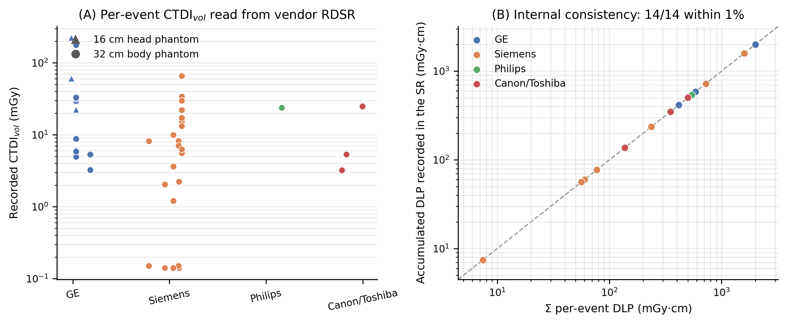
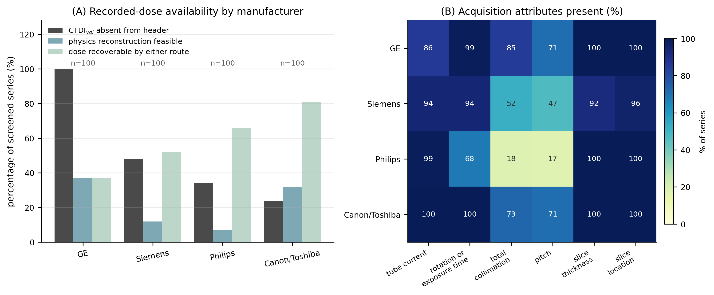
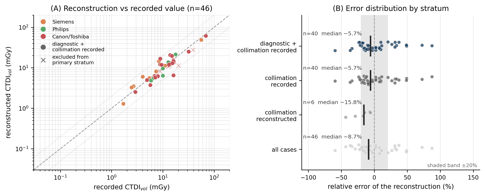
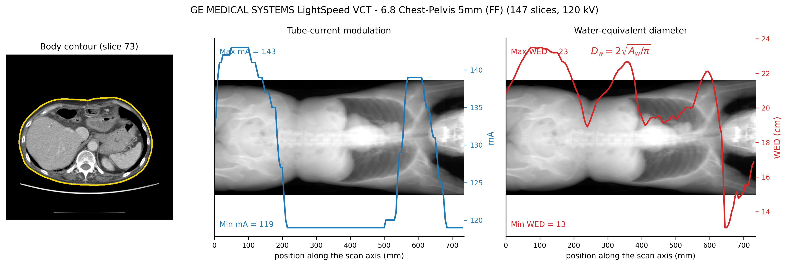
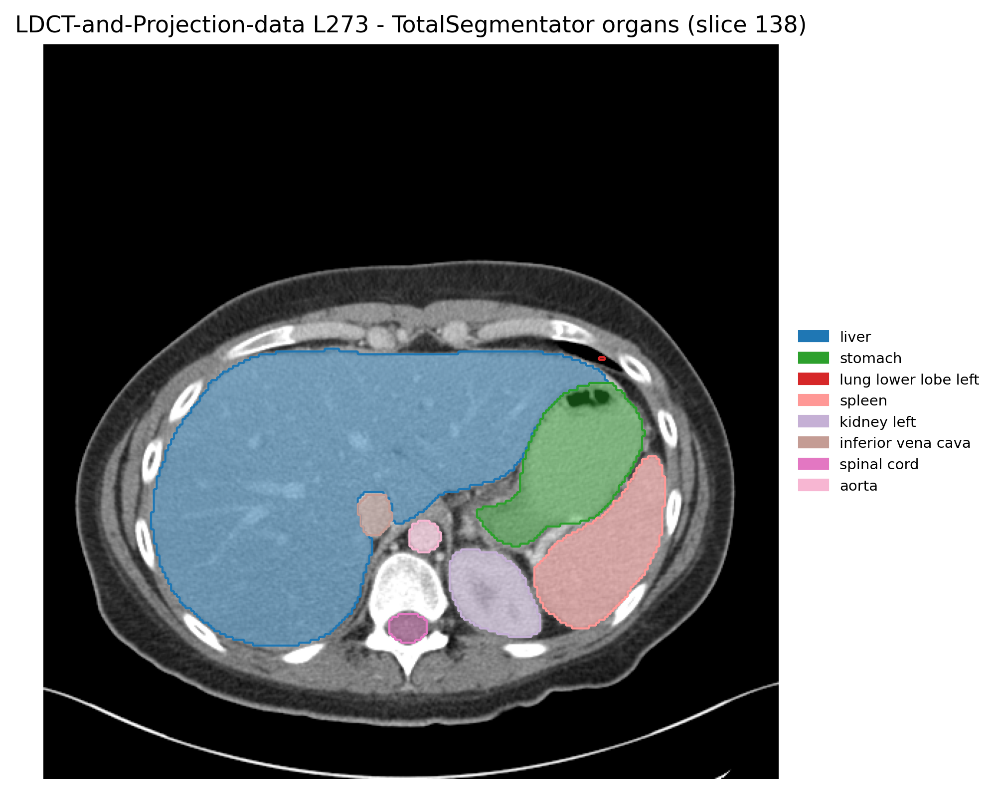
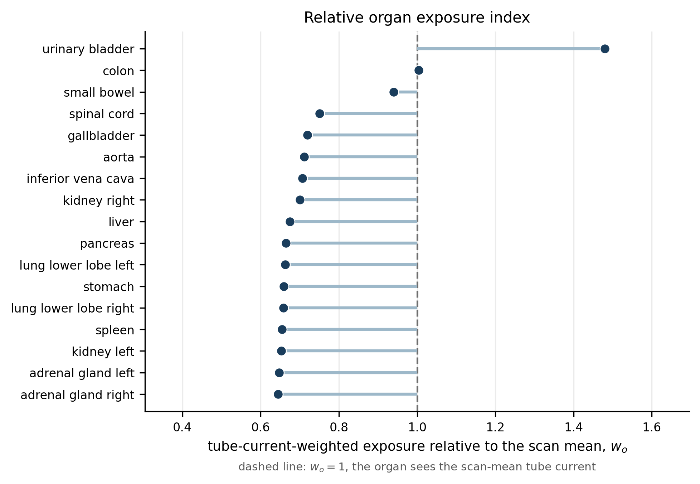

# An open-source, provenance-aware framework for reconstructing missing CT dose indices from DICOM metadata

**Shuji Yamamoto**

Institute of One, LISIT Co., Ltd., Tokyo, Japan

**Corresponding author:** Shuji Yamamoto. Email: yamamoto@lisit.jp

**Running title:** Provenance-aware CT dose reconstruction

**Article type:** Research Article

**Section:** Diagnostic and Interventional Imaging Physics

**Keywords:** computed tomography; CTDIvol; size-specific dose estimate; radiation dose structured report; open data; reproducibility

---

## Abstract

**Purpose:** Retrospective CT dose work is limited by a rarely quantified problem: the recorded dose index is frequently absent from the image header, and no dose structured report accompanies the images. We present an open-source, provenance-aware framework that recovers dose indices from the acquisition metadata that remains, distinguishes recovered values from recorded ones at every step, and makes the limits of that recovery measurable.

**Methods:** We developed `ctdose-core`, an open-source Python package released under the MIT License, to compute CTDIvol, dose-length product (DLP), size-specific dose estimate (SSDE) and effective dose. Every value carries provenance at four levels — its formula, that formula's inputs, the assumptions the reconstruction rested on, and a source classifying it as recorded, reconstructed, derived or unrecoverable — so the four are never interchangeable by accident. A vendor-neutral parser reads the CT Radiation Dose Structured Report (RDSR) from DICOM coded content items only; where no recorded index exists, CTDIvol is rebuilt from tube current, rotation time, collimation and pitch against an openly licensed table of measured normalised CTDI values, and DLP and effective dose follow from the imaged scan length and published conversion factors. SSDE follows AAPM TG-204 from an automatically contoured water-equivalent diameter, and an optional layer weights TotalSegmentator organ masks by the tube-current modulation. We evaluated the framework on 14 real RDSR objects from four manufacturers, and on a sample of 400 public CT series from The Cancer Imaging Archive (TCIA), 100 per manufacturer across 92 collections, both to assess how incomplete metadata limits recovery and, on every series the coefficient table could reach that also carried a recorded CTDIvol, to measure the reconstruction's error. Every image reproduced here derives from public TCIA data, and no imaging is redistributed.

**Results:** The parser correctly identified and parsed all 14 RDSR objects and rejected one secondary-capture dose screen; they spanned 4 manufacturers, 9 scanner models and 67 irradiation events, and two independent consistency checks passed on 14 of 14 files. In the archive sample, CTDIvol was absent from the image header in 206 of 400 series (51.5%), at rates strongly associated with manufacturer, from 24.0% to 100.0%. Of those 206, 42 (20.4%) retained enough metadata *and* a scanner in the coefficient table to reconstruct one (GE 37.0%, Canon/Toshiba 20.8%, Philips and Siemens 0%); by either route 236 of 400 series (59.0%) were dose-recoverable, leaving 164 (41.0%) unrecoverable. A further 122 series were described completely enough to reconstruct but sat on a scanner no open measurement covers, making coefficient coverage the binding constraint. Against the scanner's own recorded values (n = 46; Canon/Toshiba 27, Siemens 12, Philips 7, GE 0, no GE series carrying a recorded value to compare against), the reconstruction had a median relative error of −8.7%, and −5.7% (95% CI −12.4% to +7.8%) in the stratum recording the total collimation, with 60.0% of cases within ±20%.

**Conclusions:** Dose indices can be recovered from acquisition metadata when no recorded value survives, but only as far as that metadata and the available open measurements allow, and a recovered value is not interchangeable with a recorded one. Carrying formula-, input-, assumption- and source-level provenance makes that distinction explicit and the residual uncertainty attributable — here to an unrecorded bowtie filter, a substituted collimation or an omitted over-ranging length rather than to an unnamed model error. In the archive sample examined, availability was strongly associated with manufacturer and roughly four in ten series admitted no estimate at all, so both availability and accuracy should be reported per manufacturer rather than pooled.

---

## 1. Introduction

In most surveyed countries computed tomography is the largest single contributor to the population's collective medical exposure [1], and dose optimisation rests on measuring the dose indices that describe an examination reliably and at scale. Routine surveillance is built on the volume CT dose index (CTDIvol) and the dose-length product (DLP), both defined against a standard cylindrical phantom of 16 cm or 32 cm diameter [8]: phantom-referenced indices of scanner output, not absorbed patient dose. Because they describe the phantom rather than the patient, AAPM Task Group 204 introduced the size-specific dose estimate (SSDE), correcting CTDIvol by the water-equivalent diameter [2, 3], and national bodies publish diagnostic reference levels (DRLs) against a facility's median values [16, 17].

Modern scanners record these indices in a DICOM Radiation Dose Structured Report (RDSR) [7], and dose-management systems such as OpenREM harvest them at scale from clinical PACS [15]. That infrastructure works inside an institution but does not transfer to the public archives on which most reproducible imaging research is now built: de-identified collections generally carry no dose structured report, and their image headers often omit CTDIvol as well. A study relating image findings to the dose indices of the examinations that produced them has no recorded value to work from.

That much is familiar to anyone who has tried it; what is missing is a measurement of how bad the problem is. AAPM Report 246 catalogues the DICOM attributes organ dose estimation requires and recommends that more be standardised [4], but neither it nor, to our knowledge, any later study reports how often those attributes survive into a public archive. A PubMed and Scopus search (July 2026) returned no such quantification, so we report ours as the first we are aware of, not the first that exists.

Where the recorded index is missing there is a physically principled way out: the acquisition description public archives *do* retain — tube voltage, slice-wise tube current, rotation time, collimation, pitch and slice geometry — suffices to reconstruct CTDIvol from a scanner's normalised CTDI coefficients, the approach dose-evaluation software has taken since CT-Expo [9]. Such a reconstruction is only as good as its metadata and its coefficients, so its uncertainty must be measured rather than assumed, it must never be mistaken for a recorded value, and both the code and the coefficients must be open, because a dose figure a reader cannot re-derive is not a measurement. That last condition has become satisfiable: measured normalised CTDI values for a set of current scanners were recently published under a Creative Commons licence [20], which is what allows the reconstruction reported here to be redistributed intact.

This work contributes an open-source, provenance-aware framework for recovering CT dose indices when a recorded CTDIvol is absent. It has four elements: recovery of the indices from the acquisition metadata that survives de-identification; an explicit distinction among recorded, reconstructed, derived and unrecoverable values, so the four never blur; provenance at the level of formula, inputs, assumptions and source for every reported value; and an empirical assessment of how incomplete DICOM metadata limits recovery. The last matters most: a reconstruction whose failure modes are unmeasured cannot be relied on.

We evaluate it against real RDSR objects, to establish that a recorded index is read correctly where one exists; against a sample of public archive series, to measure how far incomplete metadata limits recovery and how accurate the reconstruction is on every series whose scanner an open coefficient table covers and whose header records a dose to compare against. That archive sample is an application of the framework and the setting in which its limits were measured — one archive, stratified by manufacturer, not a comprehensive validation across those manufacturers' scanners.

## 2. Materials and methods

### 2.1 Open dose engine and provenance model

`ctdose-core` has a functional API and a command-line interface, and depends only on `pydicom`, `numpy` and `scipy`. The four provenance levels are carried on every quantity it returns: the value and its unit, the formula, that formula's inputs and any assumption they rested on, a literature reference where one applies, and a `Source` distinguishing a value read from an RDSR or a DICOM attribute, parsed from a free-text dose comment, reconstructed from physics, or derived from other quantities. A consumer can therefore separate the four without re-tracing the computation.

Where a value could come from more than one place, an explicit ranking applies.

> RDSR > image header attribute (0018,9345) > free-text dose comment (0040,0310) > physics reconstruction.

Lower-ranked values are retained alongside the winner and their difference reported, because a disagreement between an RDSR and an image-header value usually means the wrong irradiation event was attributed, not a genuine dose discrepancy.

### 2.2 Vendor-neutral RDSR parsing

The parser is written against the coded content items of DICOM PS3.16 templates TID 10011–10013 [7] — the `DCM` coding scheme and its documented code values — rather than any vendor's layout. It walks the SR content tree and extracts, per irradiation event, the mean CTDIvol (113830), the DLP (113838), the CTDIw reference phantom (113835) and the acquisition technique, plus the study-level accumulated DLP (113813) and declared event count (113812).

An RDSR describes a whole examination, not one reconstructed series, so attributing an event to a series is an explicit step, matched on acquisition protocol name first and scanning length second. When no event can be attributed unambiguously, no recorded value is taken and the pipeline falls back to the image header or to physics: attaching another event's CTDIvol is a worse error than declining to attribute one. A CTDIvol read from an RDSR carries its own reference phantom, which overrides the body-region heuristic when the SSDE table is selected.

### 2.3 Physics reconstruction when no recorded dose exists

When no recorded CTDIvol is available, it is reconstructed from an openly licensed table of *measured* normalised CTDI values. Dinwiddie et al. published, under CC BY 4.0, the weighted CTDI per 100 mAs at pitch 1 measured on 17 scanner models from four manufacturers, tabulated by tube voltage, total collimation, reference phantom and bowtie filter [20]. From one row of that table,

$$\mathrm{CTDI_{vol}} = \frac{n\mathrm{CTDI_w}}{100}\cdot\frac{I\,t_{rot}}{p}, \qquad
\mathrm{DLP} = \mathrm{CTDI_{vol}}\cdot\frac{L_{img}}{10}, \qquad
E = \mathrm{DLP}\cdot k,$$

where $n\mathrm{CTDI_w}$ is the tabulated value for the series' tube voltage, total collimation, phantom and bowtie, $I$ the mean tube current over the series, $t_{rot}$ the rotation time, $p$ the pitch and $L_{img}$ the imaged scan length in mm; $k$ is the region- and size-specific conversion factor of ICRP Publication 103 [6]. Effective dose so obtained is a population quantity for a reference phantom, not an individual patient's dose, and the software states that on the value itself.

Two properties of this route govern how its output should be read. There is no over-beaming factor and no tube-voltage extrapolation: the table is measured at the voltage and collimation in question, so both enter by lookup rather than by model. And the reconstructed DLP omits helical over-ranging — the additional rotations outside the imaged volume — so it, and everything derived from it including $E$, is a **conservative underestimate**. That shortfall is scanner-specific and we have no open per-scanner source for it; substituting a published generic over-ranging length is future work. The omission is recorded as an assumption on the DLP and copied onto the effective dose, so neither can be quoted without it.

Selecting a row is explicit and refusable. Manufacturer and `ManufacturerModelName` must match a tabulated model exactly, or through a short alias list absorbing two typographical variants in the published annex; a family name identifying no single model is reported as unknown rather than costed against a nearby one, and matching never crosses manufacturers. A tube voltage between two tabulated voltages is interpolated as a power law and **refused** outside the measured range. Where the tabulated collimations do not include the acquisition's, the nearest measured value is used and named in the value's provenance. DICOM records no bowtie filter, so the filter conventional for the selected phantom is assumed — and where a model's table lacks that filter, the note states which was used instead.

### 2.4 Size-specific dose estimate

The water-equivalent diameter is computed from an automatically extracted body contour as $D_w = 2\sqrt{(\overline{\mathrm{HU}}/1000 + 1)\,A_{ROI}/\pi}$ [3], with $\overline{\mathrm{HU}}$ the mean Hounsfield value inside the contour and $A_{ROI}$ its area. The contour uses a fixed attenuation threshold, largest-connected-component selection and hole filling, so it needs no deep-learning dependency and is deterministic; the table and detached support hardware are excluded, interior gas retained as the definition requires. SSDE is $\mathrm{CTDI_{vol}} \cdot f(D_w)$ with $f$ interpolated from the TG-204 tables for the applicable phantom [2], or the closed-form head conversion $f = 1.9852\exp(-0.0486 D_w)$ where that applies [5]. The implementation is verified against synthetic phantoms with an analytically known answer: a uniform 0 HU disc of radius $r$ must return $D_w = 2r$ through the segmentation, and doubling the attenuation must scale it by exactly $\sqrt{2}$.

### 2.5 Deep-learning organ layer

An optional extra uses TotalSegmentator (Apache-2.0) [13], for inference only, to obtain organ masks, on which we implement the established organ-specific weighted CTDIvol of Khatonabadi et al. [10] and Tian et al. [11]. Given the slice-wise tube current $I(z)$ from (0018,1151) and an organ occupying slices $Z_o$ with per-slice voxel counts $n_o(z)$:

$$\bar{I}_o = \frac{\sum_{z \in Z_o} n_o(z)\,I(z)}{\sum_{z \in Z_o} n_o(z)}, \qquad \bar{I} = \frac{1}{|Z|}\sum_{z \in Z} I(z), \qquad (\mathrm{CTDI_{vol}})_{o} = \frac{\bar{I}_o}{\bar{I}}\,\mathrm{CTDI_{vol}}.$$

$\bar{I}_o/\bar{I}$ is the ratio Tian et al. denote $mA_{\mathrm{organ,weighted}}/mA_{\mathrm{scan}}$ and $(\mathrm{CTDI_{vol}})_{o}$ their organ-specific weighted CTDIvol; Khatonabadi et al. call the same construction a regional CTDIvol [10, 11]. We adopt their terminology rather than coining our own.

Those authors complete the chain to absorbed organ dose as $D_o = h_o \cdot (\mathrm{CTDI_{vol}})_{o}$, with $h_o$ a CTDIvol-normalised, size-dependent coefficient from Monte-Carlo simulation [11]. **We stop one step short of that.** $(\mathrm{CTDI_{vol}})_{o}$ is a dose index in mGy, not an absorbed organ dose, and converting it needs $h_o$ for the matched scanner, protocol and phantom, which we lack here. The software applies published coefficients only when the caller supplies both the coefficients and their citation, so an absolute organ dose can never be produced without an attributable source; work that does complete the chain from the same DICOM modulation profile reports agreement with measurement within about ±10% for most abdominal organs [12]. The core package never imports TotalSegmentator.

### 2.6 Auditable DRL comparison

Measured indices are compared against diagnostic reference levels; each comparison emits an alert stating the metric, the reference set and examination, the numeric excess, the ratio, the patient size band and the provenance of the measured value, with no classifier score. Because a DRL applies to the median of a representative sample rather than an individual examination, that caveat rides on every alert.

### 2.7 Data

**Layer 1 (recorded-dose parsing).** The RDSR validation set is the CT dose structured report sample collection distributed with OpenREM (GPL-3.0) [15]: 15 DICOM objects from four manufacturers, 14 of them CT Radiation Dose Structured Reports. These third-party files are not redistributed; the tests read them from a user-supplied directory and skip cleanly when absent, and only the measurements read out of them appear in our results.

**Layer 2 (public-archive sample).** CT series were drawn from The Cancer Imaging Archive [14] through its public NBIA REST interface, with no credentials and no write access, selected by DICOM `Manufacturer` and sampled round-robin across each manufacturer's collections so no single collection could dominate the rate; the sampling seed, sample sizes and access timestamps are in the released results. Each series is identified there by Series Instance UID and by the licence the archive states — Creative Commons Attribution 3.0 and 4.0 and their non-commercial variants, with 16 of 400 carrying no licence label. All collections used are publicly available and de-identified.

**Demonstration series.** The images behind the modulation, contour and organ figures are subject **L273** of the public TCIA collection *Low Dose CT Image and Projection Data* (`LDCT-and-Projection-data`, doi:10.7937/9npb-2637, CC BY 4.0) [18]: an abdominal CT on a Siemens Healthcare SOMATOM Definition AS+ with tube-current modulation, from the "Full Dose Images" series (120 kVp, 165 images). Its header records neither a CTDIvol nor a pitch nor a total collimation, which is why it also serves as the metadata example of §4; the figure script re-reads those three facts from the images rather than asserting them here.

The DICOM is not redistributed. The exact Series Instance UID and retrieval instructions are in `docs/REPRODUCING_FIGURES.md` and the accompanying machine-readable result files. No private or internally anonymised patient images are used in this work.

### 2.8 Reproducibility

Every number reported here is written by a script into machine-readable result files that ship with the software, and the manuscript quotes those files rather than restating computed values. Automated tests re-derive each quoted figure from them, recompute every summary statistic from the rows it summarises, and assert that the image figures came from a public, identified series, so neither a stale result file nor a hand-edited number can pass continuous integration. The figures are generated by script rather than drawn by hand.

## 3. Results

### 3.1 Layer 1: recorded dose is read correctly across manufacturers

Of 15 sample objects, 14 parsed as CT Radiation Dose Structured Reports; the fifteenth is a secondary-capture dose screen and was correctly rejected. The 14 span 4 manufacturers (GE, Siemens, Philips, Canon/Toshiba) and 9 scanner models, and contain 67 irradiation events, of which 44 carry a CTDIvol and 44 a DLP. Recorded CTDIvol spans 0.14–222.59 mGy and DLP 1.2–890.26 mGy·cm. Both the 16 cm head and the 32 cm body reference phantoms are represented, and a single study can mix them (Figure 1A).

Two internal consistency checks were computed per file and reported rather than assumed: the per-event DLPs summed to the accumulated DLP recorded in the same object within 1% in 14 of 14 comparable files (Figure 1B), and the number of irradiation events parsed equalled the number the report declares in 14 of 14 files. A template-blind sweep of the whole SR content tree — every occurrence of the relevant code values, wherever it sits — returned exactly what the template-navigating parser returned for CTDIvol, DLP, accumulated DLP and phantom code in every file. That sweep is an independent oracle, agreeing only if the parser has neither dropped a branch nor read a value from the wrong container; it also caught one branch the parser was skipping.

### 3.2 Layer 2a: recorded dose availability in a public archive

Four hundred CT series were screened, 100 per manufacturer, from 92 collections. CTDIvol was absent from the image header in 206 of 400 series overall (51.5%), but the pooled figure conceals the dominant effect (Figure 2A): the absence rate was 100.0% for GE, 48.0% for Siemens, 34.0% for Philips and 24.0% for Canon/Toshiba. Within one archive, recorded-dose availability was strongly associated with manufacturer ($\chi^2$(3) = 137.2, nominal p < 0.001, Cramér's V = 0.59). Because series sampled from the same collection may not be independent, the nominal p-value should be interpreted cautiously; the effect size is therefore emphasised. No series in the sample carried a usable DLP record in the free-text dose comment attribute.

Availability is only half the question: a series with no recorded dose can still be surveyed if its acquisition is described completely enough for the reconstruction to run *and* its scanner is in the coefficient table. Over the 400, the acquisition description was complete enough in 52.5% and the scanner was in the coefficient table in 28.8%; both conditions held in 22.0% of series, from 7.0% (Philips) to 37.0% (GE). That marginal rate describes the archive; the reconstruction exists to answer the conditional one. **Of the 206 series that lacked a recorded CTDIvol, 42 (20.4%) retained enough acquisition metadata to reconstruct one**, and that rate is far more manufacturer-dependent than the marginal rate suggests (Table 1): the reconstruction closes the gap for GE, where 37 of 100 dose-less series are recoverable, and none of it for Siemens or Philips.

**Table 1.** Recorded-dose availability and reconstructability by manufacturer, in 400 public CT series (100 per manufacturer).

| Manufacturer | CTDIvol absent | Of those, reconstructable | Conditional rate | Recoverable by either route |
| --- | ---: | ---: | ---: | ---: |
| GE | 100 / 100 (100.0%) | 37 | **37.0%** | 37 (37.0%) |
| Siemens | 48 / 100 (48.0%) | 0 | **0.0%** | 52 (52.0%) |
| Philips | 34 / 100 (34.0%) | 0 | **0.0%** | 66 (66.0%) |
| Canon/Toshiba | 24 / 100 (24.0%) | 5 | **20.8%** | 81 (81.0%) |
| **All** | **206 / 400 (51.5%)** | **42** | **20.4%** | **236 (59.0%)** |

There is a symmetry worth stating plainly: the manufacturer whose series never carry a recorded CTDIvol is also the one whose headers most often retain the technique needed to rebuild it. Taking both routes together, 236 of 400 series (59.0%) were dose-recoverable, leaving 164 (41.0%) that no method here can survey.

Figure 2B shows which attributes were present: tube current, slice thickness and slice location are near-universal, total collimation and pitch are not, and those two limit feasibility. Scanner coverage is the second, independent constraint, and on this sample the larger one: of 400 series the table resolved 115 model names, found 0 ambiguous, and did not cover 285. The commonest uncovered names were `Aquilion` (64 series), `Brilliance 64` (34), `Sensation 64` (18) and `SOMATOM Definition AS` (15); the first is a family name identifying no single model, reported as unknown rather than assigned to a nearby one. A further 122 series were described completely enough to reconstruct but sat on a scanner the table does not contain — the reconstruction's reach here is limited more by which scanners have been measured openly than by what de-identification removed.

### 3.3 Layer 2b: accuracy of the physics reconstruction

Reconstructing a series that carries a recorded CTDIvol anyway gives a per-series reference the archive supplies itself. Of the 194 screened series carrying a recorded CTDIvol, 53 sat on a scanner in the coefficient table and 46 of those also had complete acquisition parameters. **All 46 were evaluated**: the eligible set is defined by the table's coverage rather than sampled, so there is no download cap and no sampling seed. They comprise 45 distinct (recorded, reconstructed) pairs, public archives re-releasing the same acquisition under different collection names.

They divide **Canon/Toshiba 27, Siemens 12, Philips 7, GE 0**. GE contributes nothing, for the opposite of the usual reason: it is the best-covered manufacturer in the coefficient table and the one the reconstruction most often reaches (Table 1), but no GE series in the sample carries a recorded CTDIvol at all (100.0% absence), so the archive offers nothing to compare a GE reconstruction against. Whether the accuracy measured here transfers to GE is untested, and the Limitations return to it.

Pooled over all 46 cases the median relative error was −8.7%, with a mean absolute error of 21.7%; every recorded value in the set is a diagnostic acquisition (recorded CTDIvol of at least 0.5 mGy), so no localiser had to be removed and the diagnostic-only stratum leaves 46 cases unchanged. The stratum that isolates the dose model from the archive's metadata gaps is the one whose header records the total collimation rather than rebuilding it from table feed: n = 40, median relative error of −5.7% (95% percentile-bootstrap CI −12.4% to +7.8%), interquartile range −15.8% to +11.2%, full range −59.4% to +87.4%, mean absolute error 22.0%, with 60.0% of cases within ±20% and 92.5% within ±50%. The interval contains zero, so the spread, not the centre, is the result. Per manufacturer the medians were Canon/Toshiba (n = 21) −9.4%, Philips (n = 7) −11.7% and Siemens (n = 12) +9.7%. Of the 40, 39 are distinct (recorded, reconstructed) pairs and they come from 21 collections, so the interval may underestimate uncertainty to the extent that series from one collection are not independent.

Replacing the coefficients with measured, openly licensed ones settled a licensing question and also improved accuracy. On the same archive, the superseded run — modelled coefficients with an over-beaming term and a tube-voltage extrapolation, its result files preserved in the repository's history — gave +18.9%, a mean absolute error of 34.9% and 43.5% within ±20%; the measured coefficients give −5.7%, 22.0% and 60.0%.

Collimation provenance no longer dominates the error as it did under a formulation carrying an over-beaming factor growing as $1/h_{col}$: the present route selects a measured row by collimation, so a substituted collimation moves the answer only as far as the neighbouring row. 6 cases had to rebuild the collimation, all Canon/Toshiba, with a median error of −15.8% against −5.7% for the 40 that recorded it — a difference not separable from the manufacturer it is confounded with. Siemens contributed 12 with a recorded collimation and none without, Canon/Toshiba 21 with and 6 without, Philips 7 with and none without.

What every case does rest on is the bowtie filter. No DICOM attribute records it, so 45 of the 46 assumed the filter conventional for the selected phantom and one used the only filter its model's table provides; seven also required the nearest tabulated collimation rather than an exact one. **No case matched a tabulated technique exactly**: the reconstruction is a lookup into measured data with at least one named substitution on every value, not a reproduction of a measurement.

### 3.4 Size correction and effective dose on the surveyed series

The same 46 series were passed through the size-correction and effective-dose layers, so those components are evaluated on archive data rather than only described. Of the 46, one could not be contoured, its images being reconstructed at two matrix sizes within one series, leaving 45; we excluded 3 scans of physical test objects (radiomics or QIBA phantom collections, whose water-equivalent diameter is valid but is not a patient size) and 1 series of fewer than 10 slices, leaving **41 patient-like series**. Excluded series are retained in the released data with the flag that excluded them.

Across those 41 the measured water-equivalent diameter had a median of 30.3 cm (interquartile range 26.2–35.3 cm, full range 16.6–48.1 cm), giving TG-204 conversion factors with a median of 1.20 (IQR 1.01–1.41, range 0.71–2.01); SSDE from the recorded CTDIvol had a median of 12.5 mGy (IQR 9.5–16.1 mGy). Because SSDE is CTDIvol times that factor, the spread of the factor measures how far a phantom-referenced index departs from a size-corrected one across this cohort.

Effective dose is the clearest case of an index no archive records and these series can nonetheless supply: none carries a DLP, but a CTDIvol — recorded here, reconstructed where none is — an imaged scan length and a published conversion factor suffice to rebuild it. It could be computed for **39 of the 41**. The two exceptions are a finding in their own right: all their slices report an identical longitudinal position, so the scan range collapses to zero. SSDE has no longitudinal dependence and is unaffected, but DLP and anything derived from it are not recoverable. Across the 39, effective dose had a median of 4.6 mSv (IQR 3.0–8.1 mSv, range 0.1–22.2 mSv) — a population estimate for a reference phantom, not an individual patient's dose, and an underestimate to the extent that helical over-ranging is omitted (§2.3).

### 3.5 Size and organ-level demonstration

The size and organ layers are demonstrated on TCIA `LDCT-and-Projection-data` subject L273, an abdominal acquisition at 120 kVp over 165 images (§2.7). Tube current ranged 271–653 mA about a mean of 437.6 mA — a modulation depth (max − min) of 87.3% of the mean — over a 492 mm scan range (Figure 4).

The weighting ratio $\bar{I}_o/\bar{I}$ for all 17 segmented structures ranged from 0.645 to 1.480 (Figures 5 and 6): the organ-specific weighted CTDIvol of the urinary bladder here is 2.3 times that of the adrenal glands. Twelve of the seventeen fall below 0.72 and only the urinary bladder exceeds unity by more than 1%, which is what a single tube-current maximum near one end of the scan produces. That magnitude is a property of this examination's modulation, not a general statement; Khatonabadi et al. report the corresponding organ-to-global differences across a clinical cohort [10].

### 3.6 Data-quality findings, reported rather than corrected

Building the reference tables and analysing real data surfaced defects in the inputs. None was silently corrected; each is flagged in the shipped data, carries a regression test and is reported here.

In the published reference tables: one AAPM TG-204 measured-dimension conversion factor disagrees with the effective-diameter table at the same effective diameter, found by cross-checking the two table families against each other, and the shipped value is marked unreliable rather than adjusted; and the published annex of the coefficient database [20] contains two typographical variants of scanner model names, which the alias list of §2.3 absorbs explicitly rather than by fuzzy matching. Recorded values are screened against a plausibility range before being used as a reference, so a physically impossible one is excluded and counted rather than averaged in; none of the 46 cases evaluated here triggered it.

One paediatric chest CTDIvol DRL literal reads 141 mGy, inconsistent with adjacent age bands. Tracing it to the primary source settled it: the nationwide survey underlying the J-RIME 2015 paediatric DRLs reports a 75th-percentile CTDIvol of 14.3 mGy and DLP of 296.0 mGy·cm for chest CT at 1–5 years on the 16 cm phantom [19], so the intended value is 14 mGy and 141 is a single-digit insertion. The shipped table carries the corrected value, the source literal and that citation, so the correction can be checked rather than taken. No paediatric DRL comparison is reported in this work.

## 4. Discussion

The framework recovers a dose index where none was recorded, and the archive sample shows what governs whether it can. Availability of a recorded index differed markedly among manufacturers, by up to 76 percentage points; manufacturer is unlikely to be the whole explanation — scanner model, the site's DICOM export configuration and each collection's curation may all contribute, and this design cannot separate them — but the association is strong enough that any pooled statement that "public CT data lacks CTDIvol" is misleading in both directions. Roughly four in ten series admit no estimate by any route, which places a ceiling on retrospective dose research using such archives and is the more actionable figure for study planning.

Table 1 sharpens this: recovery is not uniform, reaching 37.0% of GE's dose-less series and none of Siemens' or Philips'. That the manufacturer with no recorded CTDIvol is also the one the reconstruction most often reaches is fortunate rather than designed, and should not be generalised to other archives or to clinical PACS, where export may be configured differently.

The binding constraint is worth separating from the metadata one, because the two have different remedies. Of the 400 series, 122 were described completely enough to reconstruct but sat on a scanner absent from the coefficient table — more than the 88 the reconstruction could actually run on. Extending an open measured database is therefore the single change that would most widen retrospective dose recovery, and it is a metrology task, not a software one. We deliberately did not close the gap by matching an uncovered model onto a nearby covered one: a `SOMATOM Definition AS+` is not an `AS20`, and a plausible-looking substitution would convert a refusal into a silent error.

This work complements established dose-management infrastructure rather than competing with it. Systems such as OpenREM harvest RDSR objects from clinical PACS at institutional scale [15], and where an RDSR exists our parser reads the same standard content items; what we add is the case where none does. The organ layer implements the weighted CTDIvol of Khatonabadi et al. [10] and Tian et al. [11], stopping short of the Monte-Carlo normalisation those authors use to reach absorbed dose; coupling this pipeline to such coefficients [12] is the natural extension. It is an optional component demonstrated on one series, not a principal claim here.

The stratified error analysis carries a message for metadata practice as much as for dosimetry, and the demonstration series is the compact worked example. Subject L273 is a modern abdominal acquisition whose header records the tube current slice by slice yet omits CTDIvol, pitch and total collimation alike. Pitch enters the reconstruction as $1/p$: were the unrecorded value here 0.6, say, an assumed 1 would cost two fifths of the index — one absent attribute, an error larger than the headline spread of §3.3 — while this subject's collection publishes, in a separate report, the CTDIvol its own images omit. Nothing about pitch or collimation identifies a patient. The theme recurs in §3.4, where two series yielded no effective dose at all because every slice reported an identical longitudinal position, and in §3.3, where every one of the 46 cases rested on an assumed bowtie filter because DICOM has no attribute for one. Retaining total collimation, pitch and slice position costs a de-identification pipeline nothing in privacy; recording the bowtie would cost a standards body one attribute. We have not costed either change, but in the first case the attributes are already there.

**Limitations.**

- The organ layer reports an organ-specific weighted CTDIvol, not an absorbed organ dose; converting it needs CTDIvol-normalised coefficients [11] we lack for these series. It is demonstrated on one series, and its spread of 0.645–1.480 reflects that acquisition's modulation rather than being general.
- **The reconstruction is unvalidated on GE.** No GE series entered the accuracy arm, because none in the sample carries a recorded CTDIvol to compare against. GE is therefore the manufacturer the reconstruction is most often *applicable* to — 37.0% of its dose-less series are reconstructable, the highest of the four — and the one whose *accuracy* is least established. Whether the −5.7% median and 22.0% mean absolute error of §3.3 transfer to GE is untested here; a study relying on reconstructed GE doses should treat that transfer as an assumption and, where possible, validate it against a source of recorded GE values such as an RDSR archive.
- Every reconstructed value rests on an assumed bowtie filter, which DICOM does not record, and 7 of 46 additionally on a substituted collimation, so the errors of §3.3 include the cost of those substitutions and are not attributable to the measured coefficients alone.
- Reconstructed DLP, and the effective dose derived from it, omit helical over-ranging and are therefore underestimates of unquantified size. We report them as such rather than applying a generic correction we could not source openly.
- Layer 1 rests on 14 objects from one sample collection — the largest openly redistributable multi-vendor RDSR set we could identify, but not a random sample of practice, and with no external ground truth.
- The accuracy arm is not a sample but the whole of what the coefficient table could reach: 46 cases, 45 distinct pairs, unbalanced across manufacturers and drawn from 21 collections in its headline stratum, so its interval may be optimistic to the extent that series within a collection are not independent.
- The coefficient table covers 17 scanner models and did not cover 285 of 400 sampled series. The archive sample is therefore neither representative of the archive nor a validation across these manufacturers' scanner ranges; the uncovered names are published in frequency order.
- The reference in §3.3 is a phantom-referenced index recorded by the scanner, not an independent dosimetric measurement and not absorbed patient dose; §3.4 characterises the archive rather than validating anything, no independent measurement of water-equivalent diameter or organ dose being available.
- The figures used the full-resolution TotalSegmentator model; the fast model gives coarser organ boundaries, which matters less for a per-slice weighting than for volumetry but is not negligible.

**Future work.** The priorities are extending the open coefficient database to the scanner families public archives actually contain, substituting a published generic over-ranging length so reconstructed DLP is no longer knowingly low, validating against a collection carrying both RDSR objects and images — which would also settle the GE question — and calibrating the organ index against published coefficients.

## 5. Conclusions

A CT dose index can be recovered from acquisition metadata when no recorded value survives, but only as far as that metadata and the available open measurements allow, and a recovered value is not interchangeable with a recorded one. Carrying formula-, input-, assumption- and source-level provenance keeps that distinction explicit and makes the residual uncertainty attributable rather than merely present: against the scanner's own recorded values the reconstruction had a median error of −5.7% and a mean absolute error of 22.0%, with every value naming the substitutions it rested on. Applying the framework to a public archive sample showed why such work has been difficult — a recorded index was missing from roughly half the series we screened, at rates strongly associated with manufacturer, and around four in ten series admitted no estimate at all, more often because no open measurement exists for the scanner than because de-identification removed the technique — and showed that both availability and accuracy must be reported per manufacturer rather than pooled.

---

## Declarations

**Conflicts of interest.** The author is the representative of LISIT Co., Ltd. (Tokyo, Japan) and Chief Executive Officer of TexelCraft OÜ, and this work was conducted under the supervision of LISIT Co., Ltd. The software is released under the MIT licence and the author has a commercial interest in downstream products that may use it. No patient or customer data were used.

**Funding.** None.

**Ethics approval and consent to participate.** Not applicable. This study used only publicly available, de-identified imaging data — TCIA collections released under Creative Commons licences [14, 18] — and third-party sample files. No new institutional review board approval and no informed consent were required.

**Data and code availability.** The software is available at https://github.com/Institute-of-One/ctdose-core under the MIT License. The version used in this study (version 0.1.1) is archived at Zenodo (https://doi.org/10.5281/zenodo.21636719). All numerical results reported here, including the rows they summarise, ship under `results/` with the scripts that generate them and the figure code.

**Imaging data are not redistributed.** Every image shown comes from a public TCIA collection and stays there, identified as described in §2.7 with retrieval instructions in `docs/REPRODUCING_FIGURES.md`. The RDSR sample objects remain with their GPL-3.0 distributor. The coefficient table is redistributed with the software under its own CC BY 4.0 licence [20], attributed in the shipped data rather than relicensed. No private, institutional or internally anonymised patient images were used at any point.

**Use of artificial intelligence.** TotalSegmentator (Apache-2.0) was used for inference only, in an optional component. A generative AI assistant (Claude, Anthropic) supported software development and drafted portions of this manuscript. All results were produced by executable code in the released repository and were re-run and verified by the author, who takes full responsibility for this work. The AI system is not an author and does not meet authorship criteria.

**Author contributions.** S.Y.: conceptualisation, methodology, software, validation, formal analysis, investigation, data curation, writing — original draft, writing — review and editing, visualisation.

---

## References

1. National Council on Radiation Protection and Measurements. *Medical Radiation Exposure of Patients in the United States*. NCRP Report No. 184. Bethesda, MD: NCRP; 2019.
2. American Association of Physicists in Medicine. *Size-Specific Dose Estimates (SSDE) in Pediatric and Adult Body CT Examinations*. AAPM Report No. 204. College Park, MD: AAPM; 2011.
3. American Association of Physicists in Medicine. *Use of Water Equivalent Diameter for Calculating Patient Size and Size-Specific Dose Estimates (SSDE) in CT*. AAPM Report No. 220. College Park, MD: AAPM; 2014.
4. American Association of Physicists in Medicine. *Estimating Patient Organ Dose with Computed Tomography: A Review of Present Methodology and Required DICOM Information*. AAPM Report No. 246. College Park, MD: AAPM; 2019.
5. American Association of Physicists in Medicine. *Size-Specific Dose Estimate for Head CT*. AAPM Report No. 293. College Park, MD: AAPM; 2019.
6. International Commission on Radiological Protection. *The 2007 Recommendations of the International Commission on Radiological Protection*. ICRP Publication 103. Ann ICRP. 2007;37(2–4).
7. National Electrical Manufacturers Association. *Digital Imaging and Communications in Medicine (DICOM) Standard, Part 16: Content Mapping Resource*. Templates TID 10011–10013, CT Radiation Dose. Rosslyn, VA: NEMA.
8. International Electrotechnical Commission. *Medical Electrical Equipment — Part 2-44: Particular Requirements for the Basic Safety and Essential Performance of X-ray Equipment for Computed Tomography*. IEC 60601-2-44. Geneva: IEC.
9. Stamm G, Nagel HD. CT-Expo — a novel program for dose evaluation in CT. *Rofo*. 2002;174(12):1570–1576. doi:10.1055/s-2002-35937
10. Khatonabadi M, Kim HJ, Lu P, et al. The feasibility of a regional CTDIvol to estimate organ dose from tube current modulated CT exams. *Med Phys*. 2013;40(5):051903. doi:10.1118/1.4798561
11. Tian X, Li X, Segars WP, Frush DP, Samei E. Prospective estimation of organ dose in CT under tube current modulation. *Med Phys*. 2015;42(4):1575–1585. doi:10.1118/1.4907955
12. Nuntue C, Matsubara K, Watanabe S, Fukushima K, Tantiwetchayanon K. Improved organ absorbed dose estimation in abdominal CT using DICOM header-based tube current modulation profiles: validation with measurements and Monte Carlo simulations. *J Appl Clin Med Phys*. 2025;26(11):e70321. doi:10.1002/acm2.70321
13. Wasserthal J, Breit H-C, Meyer MT, et al. TotalSegmentator: robust segmentation of 104 anatomic structures in CT images. *Radiol Artif Intell*. 2023;5(5):e230024. doi:10.1148/ryai.230024
14. Clark K, Vendt B, Smith K, et al. The Cancer Imaging Archive (TCIA): maintaining and operating a public information repository. *J Digit Imaging*. 2013;26(6):1045–1057. doi:10.1007/s10278-013-9622-7
15. OpenREM: open-source radiation exposure monitoring [software]. GPL-3.0. https://openrem.org (accessed 27 July 2026).
16. Japan Network for Research and Information on Medical Exposure (J-RIME). *Diagnostic Reference Levels Based on Latest Surveys in Japan — Japan DRLs 2015*. Tokyo: J-RIME; 2015.
17. Japan Network for Research and Information on Medical Exposure (J-RIME). *National Diagnostic Reference Levels in Japan — Japan DRLs 2020*. Tokyo: J-RIME; 2020.
18. Moen TR, Chen B, Holmes DR III, et al. Low-dose CT image and projection dataset. *Med Phys*. 2021;48(2):902–911. doi:10.1002/mp.14594
19. Takei Y, Miyazaki O, Matsubara K, et al. Nationwide survey of radiation exposure during pediatric computed tomography examinations and proposal of age-based diagnostic reference levels for Japan. *Pediatr Radiol*. 2016;46(2):280–285. doi:10.1007/s00247-015-3474-x
20. Dinwiddie LE, Baggett JM, Kofler JM, et al. Survey of normalized CTDIvol values across four major computed tomography vendors for use in the MIRDct software. *J Appl Clin Med Phys*. 2026;27(2):e70473. doi:10.1002/acm2.70473

---

## Figure legends and figures

**Figure 1.** Vendor-neutral parsing of recorded dose from real CT Radiation Dose Structured Reports (Layer 1). **(A)** Per-irradiation-event CTDIvol from 14 objects spanning four manufacturers; marker shape is the CTDIw reference phantom the report states. Both phantoms occur, and a single study can mix them. **(B)** Internal consistency: the sum of the per-event DLPs against the accumulated DLP recorded independently in the same object, with the identity line shown as a dashed line. Agreement within 1% held for 14 of 14 comparable files.

**Figure 2.** Recorded-dose availability in 400 public CT series, 100 per manufacturer, sampled round-robin across 92 TCIA collections (Layer 2a). **(A)** Percentage of series with CTDIvol absent from the image header, with metadata complete enough for the reconstruction, and with the dose recoverable by either route. **(B)** Percentage carrying each acquisition attribute the reconstruction uses; total collimation and pitch are the limiting ones.

**Figure 3.** Accuracy of the physics reconstruction against the scanner's recorded CTDIvol (Layer 2b, n = 46). **(A)** Reconstructed against recorded CTDIvol, with the identity line shown as a dashed line and factors of two as dotted lines. Circles are the headline stratum (acquisitions whose header records the total collimation), crosses the cases excluded from it. **(B)** Relative-error distribution by stratum, median marked. Every case is a diagnostic acquisition, so the stratification separates recorded from rebuilt collimation rather than removing a localiser.

**Figure 4.** Size and modulation analysis for the demonstration series: TCIA `LDCT-and-Projection-data` subject L273, "Full Dose Images", Siemens Healthcare SOMATOM Definition AS+, abdomen, 120 kVp, 165 images, tube-current modulated (CC BY 4.0 [18]; Series Instance UID in `docs/REPRODUCING_FIGURES.md`). Left: automatically extracted body contour on a mid-scan slice, excluding the table. Centre and right: slice-wise tube current and water-equivalent diameter over a coronal ray-sum. The axis is unlabelled anatomically because the sign of the slice-location axis depends on patient position and vendor convention.

**Figure 5.** TotalSegmentator organ masks (full-resolution model, inference only) on an abdominal slice of the same public series (subject L273), used to weight the slice-wise tube current. Seventeen dose-relevant structures were segmented; the legend lists those intersecting the displayed slice.

**Figure 6.** Tube-current weighting ratio $\bar{I}_o/\bar{I}$ for all 17 segmented structures of the same public series (subject L273); multiplying it by the global CTDIvol gives the organ-specific weighted CTDIvol of Khatonabadi et al. and Tian et al. [10, 11]. The dashed line marks unity, where an organ sees the scan-mean tube current. Values span 0.645–1.480, bounded by the modulation depth this acquisition applied ((max − min)/mean = 87.3%); that span is a property of this examination, not a general statement about how much organ dose can vary.

