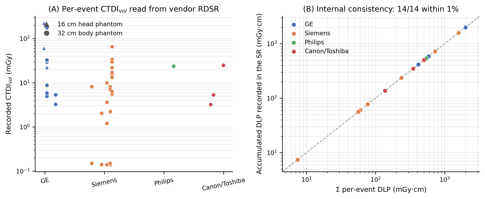
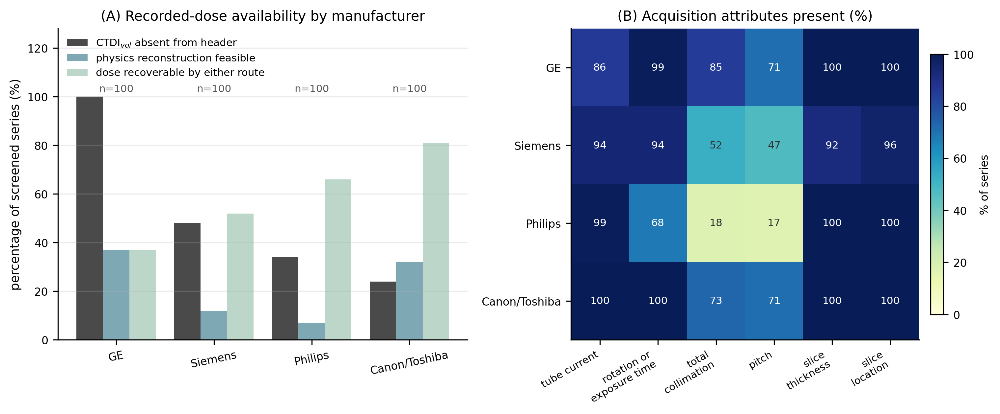
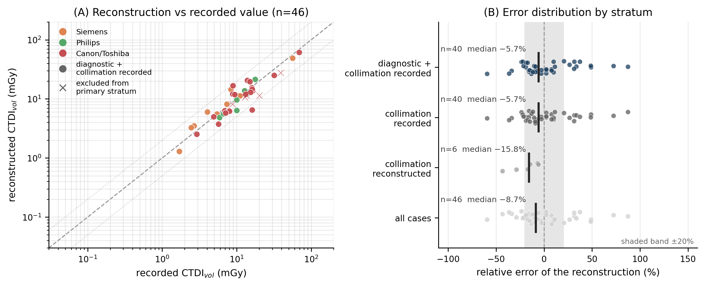

# An open-source, provenance-aware framework for reconstructing missing CT dose indices from DICOM metadata

**Shuji Yamamoto**

Institute of One, LISIT Co., Ltd., Tokyo, Japan

**Corresponding author:** Shuji Yamamoto. Email: yamamoto@lisit.jp

**Running title:** Provenance-aware CT dose reconstruction

**Article type:** Technical Note

**Section:** Diagnostic and Interventional Imaging Physics

**Keywords:** computed tomography; CTDIvol; size-specific dose estimate; radiation dose structured report; open data; reproducibility

---

## Abstract

**Background:** The recorded volume CT dose index (CTDIvol) is often absent from de-identified image headers, and public archives carry no radiation dose structured report (RDSR), leaving retrospective dose work no recorded value to use.

**Purpose:** To present an open-source, provenance-aware framework that recovers dose indices from the metadata surviving de-identification, keeps a recovered value distinguishable from a recorded one, and measures the limits of that recovery.

**Methods:** An open-source Python package (MIT License) computes CTDIvol, dose-length product (DLP), size-specific dose estimate and effective dose. Every value carries its formula, that formula's inputs, the assumptions they rested on, and a label stating whether it was read from the data or rebuilt from it. Where no recorded index survives, CTDIvol is rebuilt from tube current, rotation time, collimation and pitch using an openly licensed table of measured normalized CTDI values. I parsed 14 RDSR objects, screened 400 public CT series, and compared the reconstruction against two independent sets of recorded values: 46 archive series whose headers retained a CTDIvol, and 4 irradiation events whose GE scanners recorded one in their own dose reports.

**Results:** All 14 RDSR objects parsed, and both internal consistency checks held in 14 of 14 files. CTDIvol was absent from the image header in 206 of 400 series (51.5%), ranging from 24.0% to 100.0% by manufacturer; of those 206, 42 (20.4%) could still be reconstructed, making 236 of 400 (59.0%) dose-recoverable. Against the archive's own recorded values (n = 46) the median relative error was −8.7%, and −5.7% (95% CI −12.4% to +7.8%) in the stratum whose headers recorded the total collimation. Reconstruction over-estimated in 18 of those 46 cases and under-estimated in 28, so the error is two-sided rather than conservative. On GE, where no archive series supplies a reference, the reconstruction fell within 20% of all four recorded values (median +11.6%).

**Conclusions:** Dose indices can be recovered when no recorded value survives, but only as far as the metadata and the available open measurements allow, and provenance keeps a recovered value from being read as a recorded one.

---

## 1. Introduction

Computed tomography is the largest single contributor to collective medical exposure in most surveyed countries [1], and optimization rests on measuring CTDIvol and the dose-length product (DLP), phantom-referenced indices of scanner output [2]. Modern scanners record them in a DICOM Radiation Dose Structured Report (RDSR) [3], which dose-management systems such as OpenREM harvest from clinical PACS [4]. That infrastructure does not transfer to public imaging archives: de-identified collections generally carry no RDSR and often omit CTDIvol from the header as well, so a study relating image findings to the doses that produced them has no recorded value to work from. AAPM Report 246 catalogues the DICOM attributes organ dose estimation requires [5], but how often they survive de-identification is, to my knowledge, unreported.

Where the recorded index is missing, the surviving acquisition description suffices to reconstruct CTDIvol from a scanner's normalized CTDI coefficients, as dose-evaluation software has done since CT-Expo [6]. Such a reconstruction is only as accurate as its metadata and its coefficients, so its uncertainty must be measured rather than assumed, and both the code and the coefficients must be open. This note describes a framework meeting those conditions and measures how far it reaches.

## 2. Materials and methods

### 2.1 Dose engine and the provenance labels

`ctdose-core` has a functional API and a command-line interface, and depends only on `pydicom`, `numpy` and `scipy`. Every quantity it returns carries four levels of provenance: the value with its unit; the formula that produced it; that formula's inputs together with any assumption they rested on; and a `Source` label. The four labels are used throughout this note with these meanings:

- **recorded** — read directly from the data as the scanner wrote it, either from an RDSR or from the CTDIvol attribute (0018,9345) of the image header;
- **reconstructed** — not present in the data and rebuilt from the acquisition description and a published coefficient table (§2.3);
- **derived** — computed from another quantity already obtained by either route, such as the DLP obtained from a CTDIvol and a scan length, or an effective dose from a DLP;
- **unrecoverable** — neither present nor rebuildable, because a required attribute is absent or the scanner is not in the coefficient table. This is reported as an outcome rather than treated as an error.

A single series can offer a CTDIvol in more than one place, and the places do not always agree. The candidates are therefore ranked by how directly each records what the scanner delivered — RDSR, then image header (0018,9345), then the dose comment (0040,0310), then reconstruction — and the highest-ranked is used. **The lower-ranked candidates are not discarded**: each is retained alongside the chosen value, with its numerical difference from it, so that a disagreement between two records of the same exposure is visible to the user instead of being resolved silently.

### 2.2 RDSR parsing and its consistency checks

The parser is written against the coded content items of DICOM PS3.16 templates TID 10011–10013 [3], not any vendor's layout, extracting the per-event CTDIvol, DLP and reference phantom together with the study-level accumulated DLP and event count. Because an RDSR describes an examination rather than one series, attributing an event to a series is explicit — protocol name first, scanning length second — and where no event matches unambiguously, no recorded value is taken.

Two checks are computed for every object rather than assumed. First, the per-event DLPs are summed and compared with the accumulated DLP that the report records separately, which the parser reads by an independent traversal; agreement within 1% is required. Second, the number of irradiation events parsed is compared with the total the report itself declares. Both quantities are read from different parts of the object from the ones being checked, so agreement is evidence that neither was misread.

### 2.3 Physics reconstruction when no recorded dose exists

Where no recorded CTDIvol is available, it is reconstructed from an openly licensed table of *measured* normalized CTDI values: Dinwiddie et al. published under CC BY 4.0 the weighted CTDI per 100 mAs at pitch 1 for 17 scanner models from four manufacturers, tabulated by tube voltage, total collimation, reference phantom and bowtie filter [7]. From one row of that table,

$$\mathrm{CTDI_{vol}} = \frac{n\mathrm{CTDI_w}}{100}\cdot\frac{I\,t_{rot}}{p}, \qquad
\mathrm{DLP} = \mathrm{CTDI_{vol}}\cdot\frac{L_{img}}{10}, \qquad
E = \mathrm{DLP}\cdot k,$$

with $n\mathrm{CTDI_w}$ the tabulated value for the series' voltage, collimation, phantom and bowtie, $I$ the mean tube current, $t_{rot}$ the rotation time, $p$ the pitch, $L_{img}$ the imaged scan length in mm, and $k$ the region- and age-specific DLP-to-effective-dose coefficient of AAPM Report 96, Table 3 [8]. Those coefficients rest on ICRP Publication 60 tissue weighting, by way of the European Guidelines and the Monte Carlo organ doses from which Report 96 derived them; ICRP Publication 103 [9] revised several weighting factors, so an effective dose reported here is not an ICRP 103 quantity and says so in its own provenance. The sex-specific ICRP 103 coefficients of Deak et al. [10] are also shipped, for the alternative route the package offers. Because the table is measured at the voltage and collimation in question, neither an over-beaming factor nor a tube-voltage extrapolation enters.

The reconstructed DLP uses the imaged scan length and so omits helical over-ranging, the additional rotations at each end of a helical acquisition that irradiate beyond the reconstructed volume. For a given CTDIvol this biases the DLP low, but it does not make the reconstructed DLP an underestimate overall, because the reconstructed CTDIvol it is built on carries a two-sided error of its own (§3.3). The omission is recorded as an assumption on the value so that it can be accounted for, rather than presented as a direction of error.

Selecting a row from the coefficient table of Dinwiddie et al. [7] is explicit and refusable. The manufacturer and the scanner model must match a tabulated model exactly or through a short list of aliases denoting the same machine, and a family name that identifies no single model is reported as unknown rather than costed against a nearby one. A tube voltage falling between two tabulated voltages is interpolated as a power law, and **refused** outside the measured range rather than extrapolated. An untabulated collimation takes the nearest measured value, which is named in the provenance. No DICOM attribute records which bowtie filter was used, so the filter conventional for the selected phantom is assumed — small for the 16 cm head phantom, medium for the 32 cm body phantom — and that assumption is likewise recorded on the value.

### 2.4 Size-specific dose estimate

The water-equivalent diameter is computed from an automatically extracted body contour as $D_w = 2\sqrt{(\overline{\mathrm{HU}}/1000 + 1)\,A_{ROI}/\pi}$ [11], using a fixed attenuation threshold, largest-connected-component selection and hole filling, so it is deterministic and needs no deep-learning dependency; SSDE is $\mathrm{CTDI_{vol}} \cdot f(D_w)$, with $f$ from the AAPM TG-204 tables [12].

### 2.5 Archive sample, and what makes a series recoverable

The archive sample was drawn from The Cancer Imaging Archive [13] over its public NBIA interface, selected by DICOM `Manufacturer` and sampled round-robin across collections: 400 CT series, 100 per manufacturer, across 92 collections.

A series is counted as **dose-recoverable** if a dose index can be obtained for it by either route — that is, if it carries a recorded CTDIvol, or if no recorded value survives but the reconstruction of §2.3 can run on it. The latter requires two independent conditions to hold at once: the acquisition must be described completely enough, meaning that the tube current, the rotation or exposure time, the total collimation, the slice thickness and the slice locations are all present; **and** the scanner model must appear in the coefficient table. A series meeting neither route is counted as unrecoverable. These conditions are evaluated from the header alone and involve no dose calculation, so they are reported separately from accuracy.

### 2.6 Accuracy against the archive's own recorded values

A series that already carries a recorded CTDIvol supplies a reference the archive provides itself, allowing the reconstruction to be run as though the value were missing and the result compared with it. Of the 194 screened series carrying a recorded CTDIvol, 53 sat on a scanner in the coefficient table, and 46 of those also had complete acquisition parameters. **All 46 were evaluated**: the eligible set is defined by the table's coverage rather than sampled, so there is no cap and no sampling seed. Implausible recorded values were excluded beforehand by a physical-range test rather than by inspection. The pre-specified primary stratum is the subset whose header records the total collimation, since a substituted collimation confounds the dose model with the archive's metadata gaps.

Relative error is reported as (reconstructed − recorded) / recorded, so that the reference stands in the denominator, and confidence intervals are percentile bootstrap intervals over cases.

### 2.7 Accuracy on GE, against the scanners' own dose reports

No GE series in the archive sample carries a recorded CTDIvol (§3.2), so the archive supplies no GE reference at all. A second, independent reference was therefore taken from the RDSR objects of §2.2, which record both the CTDIvol a GE scanner computed and the technique that produced it. Predicting that CTDIvol from the recorded technique and comparing it with the recorded value tests the dose model on GE without phantom measurements.

Eligibility was fixed before any prediction was made, and every excluded event is counted with its reason. An event enters if it records a CTDIvol; if its scanner model resolves in the coefficient table; if the acquisition has table feed, that is, if it is helical; and if the tube voltage, mean tube current, exposure time per rotation, pitch, total collimation and CTDIw phantom are all recorded. The helical condition is the one that excludes most: in a stationary or cine acquisition the table does not move and the scanner accumulates CTDIvol over the whole dwell, so the exposure time per rotation no longer describes the exposure behind the recorded figure, and a single-rotation formula compared against it would report the difference as model error.

**What this arm does and does not establish.** It tests the dose model — the table coefficient, the mAs per rotation and the pitch — on GE scanners. It does **not** test recovery from a de-identified header, because the technique here is read from a structured report rather than from a stripped image header; those are separate claims. The events are also not independent patients: several come from each study, and events within a study share a scanner, a calibration and a session.

### 2.8 Data and reproducibility

The RDSR set is the sample collection distributed with OpenREM (GPL-3.0) [4]: 15 DICOM objects from four manufacturers, 14 of them CT RDSRs, read from a user-supplied directory and not redistributed.

Every number reported in this note is written into a result file by the script that computes it, and those files ship with the software. The manuscript's values are then checked against those files by the repository's automated test suite, which runs on every change to the code: a value that had been edited by hand, or left behind by an earlier run, disagrees with the file and fails the suite. The figures are regenerated from the same files by the shipped plotting code.

## 3. Results

### 3.1 Recorded dose is read correctly across manufacturers

Of 15 sample objects, 14 parsed as CT Radiation Dose Structured Reports; the fifteenth is a secondary-capture dose screen and was correctly rejected. The 14 span 4 manufacturers (GE, Siemens, Philips, Canon/Toshiba) and 9 scanner models, and hold 67 irradiation events, of which 44 carry a CTDIvol spanning 0.14–222.59 mGy; both reference phantoms occur (Figure 1A). Both consistency checks of §2.2 held in every object: the summed per-event DLPs agreed with the independently recorded accumulated DLP to within 1% in 14 of 14 comparable files (Figure 1B), and the number of events parsed equalled the number declared in 14 of 14 files.

### 3.2 Recorded-dose availability in a public archive

CTDIvol was absent from the image header in 206 of the 400 screened series (51.5%), but the pooled figure conceals the dominant effect (Figure 2A): 100.0% for GE, 48.0% for Siemens, 34.0% for Philips and 24.0% for Canon/Toshiba. Availability of a recorded CTDIvol was strongly associated with manufacturer ($\chi^2$(3) = 137.2, nominal p < 0.001, Cramér's V = 0.59); because series from the same collection may not be independent, that p-value should be read cautiously and the effect size emphasized. No series carried a usable DLP record in the dose comment.

Of the two conditions for reconstruction (§2.5), the acquisition description was complete enough in 52.5% of the 400 series and the scanner was in the coefficient table in 28.8%. **Of the 206 series that lacked a recorded CTDIvol, 42 (20.4%) retained enough acquisition metadata to reconstruct one**, a conditional rate far more manufacturer-dependent than the marginal one (Table 1). By either route, 236 of 400 series (59.0%) were dose-recoverable, leaving 164 (41.0%) that no method here can recover.

**Table 1.** Recorded-dose availability and reconstructability by manufacturer, in 400 public CT series (100 each).

| Manufacturer | CTDIvol absent | Of those, reconstructable | Conditional rate |
| --- | ---: | ---: | ---: |
| GE | 100 / 100 (100.0%) | 37 | **37.0%** |
| Siemens | 48 / 100 (48.0%) | 0 | **0.0%** |
| Philips | 34 / 100 (34.0%) | 0 | **0.0%** |
| Canon/Toshiba | 24 / 100 (24.0%) | 5 | **20.8%** |
| **All** | **206 / 400 (51.5%)** | **42** | **20.4%** |

Tube current, slice thickness and slice location were present in nearly every series; total collimation and pitch were not, and those two are what limit feasibility (Figure 2B). Scanner coverage is the larger constraint: the table resolved 115 model names, found 0 ambiguous and did not cover 285, and a further 122 series were described completely enough to reconstruct but sat on a scanner the table lacks.

### 3.3 Accuracy against the archive's own recorded values

Pooled over all 46 evaluated series the median relative error was −8.7%, with a mean absolute error of 21.7%. The 46 comprise 45 distinct (recorded, reconstructed) pairs and divide **Canon/Toshiba 27, Siemens 12, Philips 7, GE 0** — GE contributing nothing not for want of coverage, it being the best-covered manufacturer, but because no GE series in the sample carries a recorded CTDIvol at all (100.0% absence); §3.4 addresses GE separately.

In the pre-specified primary stratum, whose headers record the total collimation: n = 40, median relative error −5.7% (95% percentile-bootstrap CI −12.4% to +7.8%), mean absolute error 22.0%, and 60.0% of cases within ±20% (Figure 3). The interval contains zero, so the spread rather than the center is the result; of the 40, 39 are distinct pairs from 21 collections, so it may underestimate uncertainty.

**The error is two-sided, not conservative.** Reconstruction over-estimated the recorded CTDIvol in 18 of the 46 cases and under-estimated it in 28, spanning −59.4% to +87.4%; the largest over-estimate reconstructed 16.68 mGy where the scanner recorded 8.90 mGy (Figure 3A). A reconstructed CTDIvol therefore cannot be treated as a lower bound, and neither can a DLP or an effective dose derived from one.

No DICOM attribute records the bowtie filter, so 45 of the 46 assumed the filter conventional for the selected phantom and seven also took the nearest tabulated collimation: **no case matched a tabulated technique exactly**. Per-manufacturer and per-stratum error detail, the size-correction and effective-dose results, the uncovered model names and the data-quality defects found in the published reference tables are in Supplementary Material.

### 3.4 Accuracy on GE, against the scanners' own dose reports

The three GE objects hold 35 irradiation events, 15 of which record a CTDIvol. Applying the criteria of §2.7, 9 of those 15 were excluded for having no table feed and 2 because their scanner, a LightSpeed RT16, is the radiotherapy configuration and not the tabulated diagnostic LightSpeed 16; 4 events from 2 scanner models were evaluated (Table 2).

All four fell within 20% of the value the scanner recorded, with a median of +11.6% and a range of +6.1% to +16.4%. Inverting the formula on the recorded values gives an implied coefficient of 8.48 to 8.74 mGy per 100 mAs across both models, both pitches and four mAs settings — a narrower band than the errors themselves, which locates the residual in the choice of table row rather than in the formula.

That choice is itself informative. Both objects record a total collimation of 2.5 or 5.0 mm on 64-slice scanners, which the table does not hold, so each case took the nearest measured row at 10 mm. Taken at face value, one 468 mm helical pass at a 2.5 mm beam would need 97 s of continuous rotation against 6 s at 40 mm, so the recorded field is not a total beam width — most plausibly a single detector row or a nominal reconstructed thickness. The 20 mm row would have given a median error of −1.2%, reported here as a sensitivity and not adopted, since selecting the best-agreeing row would fit a free parameter to four observations.

**Table 2.** Reconstruction against the CTDIvol recorded by GE scanners in their own dose reports, for the four irradiation events meeting the criteria of §2.7. All are helical acquisitions on the 32 cm body phantom at 120 kVp.

| Scanner | mAs/rotation | Pitch | Recorded (mGy) | Reconstructed (mGy) | Error |
| --- | ---: | ---: | ---: | ---: | ---: |
| Optima CT660 | 51.0 | 1.38 | 3.23 | 3.43 | **+6.1%** |
| Optima CT660 | 60.0 | 0.98 | 5.30 | 5.68 | **+7.1%** |
| LightSpeed VCT | 100.0 | 0.97 | 8.74 | 10.18 | **+16.4%** |
| LightSpeed VCT | 80.0 | 1.38 | 4.93 | 5.72 | **+16.1%** |

## 4. Discussion

Availability differed among manufacturers by up to 76 percentage points. Manufacturer is unlikely to be the whole explanation, since scanner model and export configuration may contribute, but the association is strong enough that any pooled statement that "public CT data lacks CTDIvol" misleads in both directions. Roughly four in ten series admit no estimate by any route, which caps what retrospective dose research on such data can cover.

The coefficient constraint is worth separating from the metadata one, because the two have different remedies. Of the 400 series, 122 were described completely enough to reconstruct but sat on a scanner absent from the coefficient table — more than the 88 the reconstruction could run on. Extending an open measured database is therefore the single change that would most widen retrospective dose recovery, and it is a metrology task, not a software one. I did not close the gap by matching an uncovered model onto a nearby covered one: a plausible substitution would convert a refusal into a silent error, which is why declining to read a LightSpeed RT16 as a LightSpeed 16 cost two of the six otherwise-eligible GE events.

Where an RDSR exists, this parser reads the same content items that systems such as OpenREM harvest [4]; what is added here is the case where none does. The contribution is not another CTDIvol calculation but a decision framework: when retrospective recovery is defensible, which assumptions govern it, and when the data support none. A reconstructed index is usable because its provenance and uncertainty travel with it, and unusable the moment it is quoted as though it had been recorded; it is no substitute for prospective RDSR-based dose monitoring, and it gives no patient's absorbed dose. An optional organ-weighting layer and a patient-specific absorbed-organ-dose extension are the subject of separate work.

**Limitations.** Every reconstructed value rests on an assumed bowtie filter. Scanners carry filters beyond the three the table measures — for pediatric patients, for cardiac acquisitions, and for differently sized bodies — and no DICOM attribute records which was used, so the assumption cannot be checked against the data. Its weight can be bounded from the table itself: across the 605 comparisons in which more than one filter was measured for the same model, voltage, collimation and phantom, substituting a different filter for the assumed one moves nCTDIw by a median of 12.2%, with 82% of comparisons within 20% and an extreme of +110%. That sets the scale of this assumption's contribution to the errors in §3.3, and a scanner whose clinical filter departs systematically from the conventional one would be biased throughout. Seven of the 46 archive cases rest on a substituted collimation as well.

The GE arm is small and indirect: four events on two models, validating the dose model and not recovery from a de-identified header, and not independent patients. The GE conditional rate in Table 1 therefore remains unvalidated against a header-derived reference, because none exists. Reconstructed DLP omits helical over-ranging, which biases it low for a given CTDIvol, but the reconstructed CTDIvol is two-sided (§3.3), so neither a DLP nor an effective dose from one is a bound in either direction. Effective doses here carry ICRP 60 tissue weighting through the Report 96 coefficients [8] and would differ under the revised weighting of ICRP 103 [9,10]. The RDSR arm rests on 14 objects from one collection with no external ground truth, and the table did not cover 285 of 400 sampled series, so the accuracy arm is neither representative nor a validation across these scanner ranges — and its reference is an index the scanner itself computed, not an independent measurement.

## 5. Conclusions

A CT dose index can be recovered from acquisition metadata when no recorded value survives, but only as far as that metadata and the available open measurements allow, and a recovered value is not interchangeable with a recorded one. Formula-, input-, assumption- and source-level provenance keeps that distinction explicit and the residual uncertainty attributable. A recorded index was missing from roughly half the series screened, and four in ten admitted no estimate at all. The reconstruction's error is two-sided, so a recovered index must not be read as a conservative bound. Availability should be reported by manufacturer.

---

## Declarations

**Conflicts of interest.** The author is the representative of LISIT Co., Ltd. (Tokyo, Japan) and Chief Executive Officer of TexelCraft OÜ, and this work was conducted under the supervision of LISIT Co., Ltd. The software is released under the MIT License and the author has a commercial interest in downstream products that may use it. No patient or customer data were used.

**Funding.** None.

**Ethics approval and consent to participate.** Not applicable. This study used only publicly available, de-identified imaging data — TCIA collections released under Creative Commons licenses [13] — and third-party sample files, so no review board approval or informed consent was required. No imaging is redistributed: the series analyzed stay in their public collections and the RDSR samples with their GPL-3.0 distributor, and the coefficient table is redistributed under its own CC BY 4.0 license [7]. No private or internally anonymized images were used.

**Data and code availability.** The software is available at https://github.com/Institute-of-One/ctdose-core under the MIT License. The version used in this study (version 0.1.1) is archived at Zenodo (https://doi.org/10.5281/zenodo.21636719). All numerical results reported here, including the rows they summarize, ship under `results/` with the scripts that generate them and the figure code.

**Use of artificial intelligence.** A generative AI assistant (Claude, Anthropic) supported software development and drafted portions of this manuscript. All results were produced by executable code in the released repository and were re-run and verified by the author, who takes full responsibility for this work. The AI system is not an author and does not meet authorship criteria.

**Author contributions.** S.Y.: conceptualization, methodology, software, validation, formal analysis, investigation, data curation, writing — original draft, writing — review and editing, visualization.

---

## References

1. National Council on Radiation Protection and Measurements. *Medical Radiation Exposure of Patients in the United States*. NCRP Report No. 184. Bethesda, MD: NCRP; 2019.
2. International Electrotechnical Commission. *Medical Electrical Equipment — Part 2-44: Particular Requirements for CT*. IEC 60601-2-44. Geneva: IEC.
3. National Electrical Manufacturers Association. *DICOM Standard, Part 16: Content Mapping Resource*. Templates TID 10011–10013, CT Radiation Dose. Rosslyn, VA: NEMA.
4. OpenREM: open-source radiation exposure monitoring [software]. GPL-3.0. https://openrem.org (accessed 27 July 2026).
5. American Association of Physicists in Medicine. *Estimating Patient Organ Dose with Computed Tomography: A Review of Present Methodology and Required DICOM Information*. AAPM Report No. 246. College Park, MD: AAPM; 2019.
6. Stamm G, Nagel HD. CT-Expo — a novel program for dose evaluation in CT. *Rofo*. 2002;174(12):1570–1576. doi:10.1055/s-2002-35937
7. Dinwiddie LE, Baggett JM, Kofler JM, et al. Survey of normalized CTDIvol values across four major computed tomography vendors for use in the MIRDct software. *J Appl Clin Med Phys*. 2026;27(2):e70473. doi:10.1002/acm2.70473
8. American Association of Physicists in Medicine. *The Measurement, Reporting, and Management of Radiation Dose in CT*. AAPM Report No. 96. College Park, MD: AAPM; 2008.
9. International Commission on Radiological Protection. *The 2007 Recommendations of the ICRP*. ICRP Publication 103. Ann ICRP. 2007;37(2–4).
10. Deak PD, Smal Y, Kalender WA. Multisection CT protocols: sex- and age-specific conversion factors used to determine effective dose from dose-length product. *Radiology*. 2010;257(1):158–166. doi:10.1148/radiol.10100047
11. American Association of Physicists in Medicine. *Use of Water Equivalent Diameter for Calculating Patient Size and Size-Specific Dose Estimates (SSDE) in CT*. AAPM Report No. 220. College Park, MD: AAPM; 2014.
12. American Association of Physicists in Medicine. *Size-Specific Dose Estimates (SSDE) in Pediatric and Adult Body CT Examinations*. AAPM Report No. 204. College Park, MD: AAPM; 2011.
13. Clark K, Vendt B, Smith K, et al. The Cancer Imaging Archive (TCIA): maintaining and operating a public information repository. *J Digit Imaging*. 2013;26(6):1045–1057. doi:10.1007/s10278-013-9622-7

---

## Figure legends and figures

**Figure 1.** *Vendor-neutral parsing of recorded dose from real CT Radiation Dose Structured Reports.* **(A)** Per-event CTDIvol from 14 objects spanning four manufacturers; marker shape is the reference phantom stated. **(B)** Sum of the per-event DLPs against the accumulated DLP recorded independently in the same object.

**Figure 2.** *Recorded-dose availability in 400 public CT series, 100 per manufacturer, across 92 TCIA collections.* **(A)** Percentage with CTDIvol absent from the header, with metadata complete enough to reconstruct it, and with the dose recoverable by either route. **(B)** Percentage carrying each acquisition attribute.

**Figure 3.** *Accuracy of the reconstruction against the scanner's recorded CTDIvol (n = 46).* **(A)** Reconstructed against recorded, identity line dashed, factors of two dotted; circles are the primary stratum. Points above the identity line are over-estimates, of which there are 18. **(B)** Relative-error distribution by stratum, median marked.

