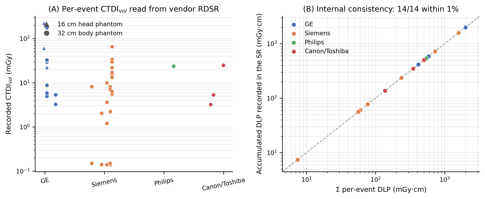
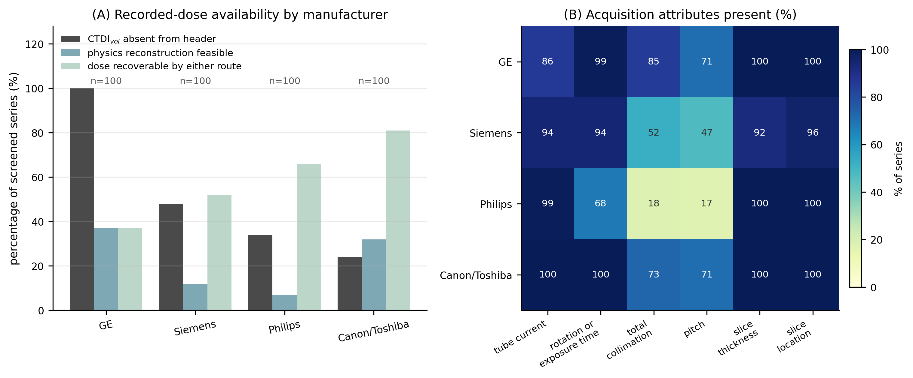
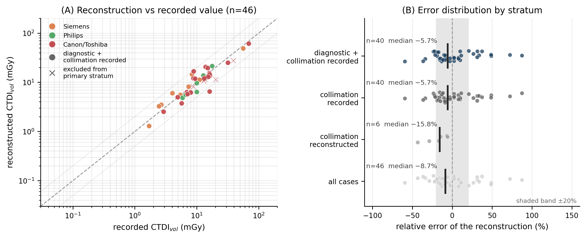

# An open-source, provenance-aware framework for reconstructing missing CT dose indices from DICOM metadata

**Running title:** Provenance-aware CT dose reconstruction

**Article type:** Technical Note

**Section:** Diagnostic and Interventional Imaging Physics

**Keywords:** computed tomography; CTDIvol; size-specific dose estimate; radiation dose structured report; open data; reproducibility

---

## Abstract

**Background:** The recorded volume CT dose index (CTDIvol) is often absent from de-identified image headers, and public archives carry no radiation dose structured report (RDSR), leaving retrospective dose work no recorded value to use.

**Purpose:** To present an open-source, provenance-aware framework that recovers dose indices from the metadata surviving de-identification, keeps a recovered value distinguishable from a recorded one, and measures the limits of that recovery.

**Methods:** An open-source Python package (MIT License) computes CTDIvol, dose-length product, size-specific dose estimate and effective dose, tagging every value with its formula, inputs, assumptions and a source marking it recorded, reconstructed, derived or unrecoverable. Where no recorded index survives, CTDIvol is rebuilt from tube current, rotation time, collimation and pitch against an openly licensed table of measured normalised CTDI values. We evaluated 14 RDSR objects and 400 public CT series.

**Results:** All 14 RDSR objects parsed, two consistency checks passing on 14 of 14 files. CTDIvol was absent from the image header in 206 of 400 series (51.5%), from 24.0% to 100.0% by manufacturer; of those 206, 42 (20.4%) were reconstructable, making 236 of 400 (59.0%) dose-recoverable. Against recorded values (n = 46) the median relative error was −8.7%, and −5.7% (95% CI −12.4% to +7.8%) where the header recorded the total collimation.

**Conclusion:** Dose indices can be recovered when no recorded value survives, but only as far as the metadata and available open measurements allow, and provenance keeps a recovered value from being read as a recorded one.

---

## 1. Introduction

Computed tomography is the largest single contributor to collective medical exposure in most surveyed countries [1], and optimisation rests on measuring CTDIvol and the dose-length product (DLP), phantom-referenced indices of scanner output [2]. Modern scanners record them in a DICOM Radiation Dose Structured Report (RDSR) [3], which dose-management systems such as OpenREM harvest from clinical PACS [4]. That infrastructure does not transfer to public imaging archives: de-identified collections generally carry no RDSR and often omit CTDIvol from the header as well, so a study relating image findings to the doses that produced them has no recorded value to work from. AAPM Report 246 catalogues the DICOM attributes organ dose estimation requires [5], but how often they survive de-identification is, to our knowledge, unreported.

Where the recorded index is missing, the surviving acquisition description suffices to reconstruct CTDIvol from a scanner's normalised CTDI coefficients, as dose-evaluation software has done since CT-Expo [6]. Such a reconstruction is only as good as its metadata and its coefficients, so its uncertainty must be measured rather than assumed and both code and coefficients must be open. This note describes a framework meeting those conditions and measures how far it reaches.

## 2. Materials and methods

### 2.1 Dose engine, provenance and RDSR parsing

The package has a functional API and a command-line interface, and depends only on `pydicom`, `numpy` and `scipy`. Every quantity it returns carries four provenance levels — the value and its unit, the formula, that formula's inputs and any assumption they rested on, and a `Source` marking it recorded, reconstructed, derived or unrecoverable. Where a value could come from more than one place a ranking applies (RDSR > image header (0018,9345) > dose comment (0040,0310) > reconstruction) and the losers are kept with their difference reported.

The parser is written against the coded content items of DICOM PS3.16 templates TID 10011–10013 [3], not any vendor's layout, extracting the per-event CTDIvol, DLP and reference phantom with the study-level accumulated DLP and event count. Because an RDSR describes an examination rather than one series, attributing an event to a series is explicit — protocol name first, scanning length second — and where none matches unambiguously no recorded value is taken.

### 2.2 Physics reconstruction when no recorded dose exists

Where no recorded CTDIvol is available it is reconstructed from an openly licensed table of *measured* normalised CTDI values: Dinwiddie et al. published under CC BY 4.0 the weighted CTDI per 100 mAs at pitch 1 for 17 scanner models from four manufacturers, tabulated by tube voltage, total collimation, reference phantom and bowtie filter [7]. From one row,

$$\mathrm{CTDI_{vol}} = \frac{n\mathrm{CTDI_w}}{100}\cdot\frac{I\,t_{rot}}{p}, \qquad
\mathrm{DLP} = \mathrm{CTDI_{vol}}\cdot\frac{L_{img}}{10}, \qquad
E = \mathrm{DLP}\cdot k,$$

with $n\mathrm{CTDI_w}$ the tabulated value for the series' voltage, collimation, phantom and bowtie, $I$ the mean tube current, $t_{rot}$ the rotation time, $p$ the pitch, $L_{img}$ the imaged scan length in mm and $k$ the conversion factor of ICRP Publication 103 [8]. Because the table is measured at the voltage and collimation in question, neither an over-beaming factor nor a tube-voltage extrapolation enters. The reconstructed DLP omits helical over-ranging, so it and the effective dose from it are a **conservative underestimate**, recorded as an assumption on the value.

Row selection is explicit and refusable: manufacturer and model must match exactly or through a short alias list, and a family name identifying no single model is reported as unknown rather than costed against a nearby one. A voltage between tabulated voltages is interpolated as a power law and **refused** outside the measured range; an untabulated collimation takes the nearest measured value, named in the provenance. DICOM records no bowtie filter, so the conventional one for the phantom is assumed.

### 2.3 Size-specific dose estimate

The water-equivalent diameter is computed from an automatically extracted body contour as $D_w = 2\sqrt{(\overline{\mathrm{HU}}/1000 + 1)\,A_{ROI}/\pi}$ [9], using a fixed attenuation threshold, largest-connected-component selection and hole filling, so it is deterministic and needs no deep-learning dependency; SSDE is $\mathrm{CTDI_{vol}} \cdot f(D_w)$, with $f$ from the AAPM TG-204 tables [10].

### 2.4 Data and reproducibility

The RDSR validation set is the sample collection distributed with OpenREM (GPL-3.0) [4]: 15 DICOM objects from four manufacturers, 14 of them CT RDSRs, read from a user-supplied directory and not redistributed. The archive sample was drawn from The Cancer Imaging Archive [11] over its public NBIA interface, selected by DICOM `Manufacturer` and sampled round-robin across collections. Every number here is written by a script into result files that ship with the software and re-derived from them by automated tests, so no stale or hand-edited figure passes continuous integration.

## 3. Results

### 3.1 Recorded dose is read correctly across manufacturers

Of 15 sample objects, 14 parsed as CT Radiation Dose Structured Reports; the fifteenth is a secondary-capture dose screen and was rejected. The 14 span 4 manufacturers (GE, Siemens, Philips, Canon/Toshiba) and 9 scanner models and hold 67 irradiation events, of which 44 carry a CTDIvol spanning 0.14–222.59 mGy; both reference phantoms occur (Figure 1A). Two consistency checks were computed per file rather than assumed: per-event DLPs summed to the independently recorded accumulated DLP within 1% in 14 of 14 comparable files (Figure 1B), and events parsed equalled the number the report declares in 14 of 14 files.

### 3.2 Recorded-dose availability in a public archive

Four hundred CT series were screened, 100 per manufacturer, across 92 collections. CTDIvol was absent from the image header in 206 of 400 series (51.5%), but the pooled figure conceals the dominant effect (Figure 2A): 100.0% for GE, 48.0% for Siemens, 34.0% for Philips and 24.0% for Canon/Toshiba. Availability was strongly associated with manufacturer ($\chi^2$(3) = 137.2, nominal p < 0.001, Cramér's V = 0.59); because series from the same collection may not be independent, that p-value should be read cautiously and the effect size emphasised. No series carried a usable DLP record in the dose comment.

A series with no recorded dose can still be surveyed if its acquisition is described completely enough *and* its scanner is in the coefficient table: the description was complete enough in 52.5% of the 400, the scanner in the table in 28.8%. **Of the 206 series that lacked a recorded CTDIvol, 42 (20.4%) retained enough acquisition metadata to reconstruct one**, a conditional rate far more manufacturer-dependent than the marginal one (Table 1). By either route 236 of 400 series (59.0%) were dose-recoverable, leaving 164 (41.0%) that no method here can survey.

**Table 1.** Recorded-dose availability and reconstructability by manufacturer, in 400 public CT series (100 each).

| Manufacturer | CTDIvol absent | Of those, reconstructable | Conditional rate |
| --- | ---: | ---: | ---: |
| GE | 100 / 100 (100.0%) | 37 | **37.0%** |
| Siemens | 48 / 100 (48.0%) | 0 | **0.0%** |
| Philips | 34 / 100 (34.0%) | 0 | **0.0%** |
| Canon/Toshiba | 24 / 100 (24.0%) | 5 | **20.8%** |
| **All** | **206 / 400 (51.5%)** | **42** | **20.4%** |

Tube current, slice thickness and slice location are near-universal; total collimation and pitch are not, and those two limit feasibility (Figure 2B). Scanner coverage is the larger constraint: the table resolved 115 model names, found 0 ambiguous and did not cover 285, and a further 122 series were described completely enough to reconstruct but sat on a scanner it lacks.

### 3.3 Accuracy of the physics reconstruction

A series that already carries a recorded CTDIvol gives a reference the archive supplies itself. Of the 194 screened series carrying one, 53 sat on a scanner in the coefficient table and 46 of those also had complete acquisition parameters. **All 46 were evaluated**: the eligible set is defined by the table's coverage rather than sampled. They comprise 45 distinct (recorded, reconstructed) pairs and divide **Canon/Toshiba 27, Siemens 12, Philips 7, GE 0** — GE contributing nothing not for want of coverage, it being the best-covered manufacturer, but because no GE series in the sample carries a recorded CTDIvol at all (100.0% absence).

Pooled over all 46 the median relative error was −8.7%, with a mean absolute error of 21.7%. The stratum isolating the dose model from the archive's metadata gaps is the one whose header records the total collimation: n = 40, median relative error −5.7% (95% percentile-bootstrap CI −12.4% to +7.8%), mean absolute error 22.0%, 60.0% of cases within ±20% (Figure 3). The interval contains zero, so the spread, not the centre, is the result; of the 40, 39 are distinct pairs from 21 collections, so it may underestimate uncertainty.

No DICOM attribute records the bowtie filter, so 45 of the 46 assumed the filter conventional for the selected phantom and seven also took the nearest tabulated collimation: **no case matched a tabulated technique exactly**. Per-manufacturer and per-stratum error detail, the size-correction and effective-dose results, the uncovered model names and the data-quality defects found in the published reference tables are in Supplementary Material.

## 4. Discussion

Availability differed among manufacturers by up to 76 percentage points. Manufacturer is unlikely to be the whole explanation, since scanner model and export configuration may contribute, but the association is strong enough that any pooled statement that "public CT data lacks CTDIvol" misleads in both directions. Roughly four in ten series admit no estimate by any route, which caps what retrospective dose research on such data can cover.

The coefficient constraint is worth separating from the metadata one, because the two have different remedies. Of the 400 series, 122 were described completely enough to reconstruct but sat on a scanner absent from the coefficient table — more than the 88 the reconstruction could run on. Extending an open measured database is therefore the single change that would most widen retrospective dose recovery, and it is a metrology task, not a software one. We did not close the gap by matching an uncovered model onto a nearby covered one: a plausible substitution would convert a refusal into a silent error.

Where an RDSR exists our parser reads the same content items systems such as OpenREM harvest [4]; we add the case where none does. The contribution is not another CTDIvol calculation but a decision framework: when retrospective recovery is defensible, which assumptions govern it, and when the data support none. A reconstructed index is usable because its provenance and uncertainty travel with it, and unusable the moment it is quoted as though it had been recorded; it is no substitute for prospective RDSR-based dose monitoring and gives no patient's absorbed dose. An optional organ-weighting layer and a patient-specific absorbed-organ-dose extension are the subject of separate work.

**Limitations.** **The reconstruction is unvalidated on GE**, no GE series entering the accuracy arm for want of a recorded value to compare against, so the manufacturer it most often applies to is the one whose accuracy is least established. Every reconstructed value rests on an assumed bowtie filter, and 7 of 46 additionally on a substituted collimation. Reconstructed DLP, and the effective dose from it, are underestimates of unquantified size. The RDSR arm rests on 14 objects from one collection with no external ground truth, and the coefficient table did not cover 285 of 400 sampled series, so the accuracy arm is neither representative nor a validation across these scanner ranges — and its reference is an index recorded by the scanner, not an independent measurement.

## 5. Conclusions

A CT dose index can be recovered from acquisition metadata when no recorded value survives, but only as far as that metadata and the available open measurements allow, and a recovered value is not interchangeable with a recorded one. Formula-, input-, assumption- and source-level provenance keeps that distinction explicit and the residual uncertainty attributable. A recorded index was missing from roughly half the series screened, and four in ten admitted no estimate at all. Availability should be reported by manufacturer.

---

## Declarations

**Conflicts of interest.** A potential conflict of interest, arising from a commercial interest in downstream products that may use this software, is disclosed in full on the title page. No patient or customer data were used.

**Funding.** None.

**Ethics approval and consent to participate.** Not applicable. This study used only publicly available, de-identified imaging data — TCIA collections released under Creative Commons licences [11] — and third-party sample files, so no review board approval or informed consent was required. No imaging is redistributed: the series analysed stay in their public collections and the RDSR samples with their GPL-3.0 distributor, and the coefficient table is redistributed under its own CC BY 4.0 licence [7]. No private or internally anonymised images were used.

**Data and code availability.** The software and all numerical results are available in a public repository under the MIT License; the repository URL and the archived-version DOI are withheld here for double-masked review and are provided on the title page. The results reported here, including the rows they summarise, ship under `results/` with the scripts that generate them and the figure code.

**Use of artificial intelligence.** A generative AI assistant (Claude, Anthropic) supported software development and drafted portions of this manuscript. All results were produced by executable code in the released repository and were re-run and verified by the author, who takes full responsibility for this work. The AI system is not an author and does not meet authorship criteria.

**Author contributions.** Author contributions are provided on the title page.

---

## References

1. National Council on Radiation Protection and Measurements. *Medical Radiation Exposure of Patients in the United States*. NCRP Report No. 184. Bethesda, MD: NCRP; 2019.
2. International Electrotechnical Commission. *Medical Electrical Equipment — Part 2-44: Particular Requirements for CT*. IEC 60601-2-44. Geneva: IEC.
3. National Electrical Manufacturers Association. *DICOM Standard, Part 16: Content Mapping Resource*. Templates TID 10011–10013, CT Radiation Dose. Rosslyn, VA: NEMA.
4. OpenREM: open-source radiation exposure monitoring [software]. GPL-3.0. https://openrem.org (accessed 27 July 2026).
5. American Association of Physicists in Medicine. *Estimating Patient Organ Dose with Computed Tomography: A Review of Present Methodology and Required DICOM Information*. AAPM Report No. 246. College Park, MD: AAPM; 2019.
6. Stamm G, Nagel HD. CT-Expo — a novel program for dose evaluation in CT. *Rofo*. 2002;174(12):1570–1576. doi:10.1055/s-2002-35937
7. Dinwiddie LE, Baggett JM, Kofler JM, et al. Survey of normalized CTDIvol values across four major computed tomography vendors for use in the MIRDct software. *J Appl Clin Med Phys*. 2026;27(2):e70473. doi:10.1002/acm2.70473
8. International Commission on Radiological Protection. *The 2007 Recommendations of the ICRP*. ICRP Publication 103. Ann ICRP. 2007;37(2–4).
9. American Association of Physicists in Medicine. *Use of Water Equivalent Diameter for Calculating Patient Size and Size-Specific Dose Estimates (SSDE) in CT*. AAPM Report No. 220. College Park, MD: AAPM; 2014.
10. American Association of Physicists in Medicine. *Size-Specific Dose Estimates (SSDE) in Pediatric and Adult Body CT Examinations*. AAPM Report No. 204. College Park, MD: AAPM; 2011.
11. Clark K, Vendt B, Smith K, et al. The Cancer Imaging Archive (TCIA): maintaining and operating a public information repository. *J Digit Imaging*. 2013;26(6):1045–1057. doi:10.1007/s10278-013-9622-7

---

## Figure legends and figures

**Figure 1.** Vendor-neutral parsing of recorded dose from real CT Radiation Dose Structured Reports. **(A)** Per-event CTDIvol from 14 objects spanning four manufacturers; marker shape is the reference phantom stated. **(B)** Sum of the per-event DLPs against the accumulated DLP recorded independently in the same object.

**Figure 2.** Recorded-dose availability in 400 public CT series, 100 per manufacturer, across 92 TCIA collections. **(A)** Percentage with CTDIvol absent from the header, with metadata complete enough to reconstruct it, and with the dose recoverable by either route. **(B)** Percentage carrying each acquisition attribute.

**Figure 3.** Accuracy of the reconstruction against the scanner's recorded CTDIvol (n = 46). **(A)** Reconstructed against recorded, identity line dashed, factors of two dotted; circles are the headline stratum. **(B)** Relative-error distribution by stratum, median marked.

